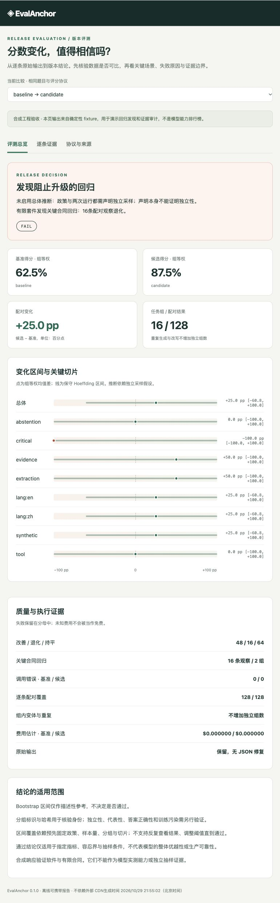

# v0.1 历史说明

以下保留 v0.1 能力与证据边界。命令仍从项目根目录运行；当前 v0.2 包要求 Python 3.12+，主线见 [当前 README](../README.md)。

# EvalAnchor

**把大模型评测结果变成可以复核的版本决策。**

模型平均分上涨了，关键场景却退化；两次结果题目不同、漏了失败样本，或评分规则已改变——这些情况下，一个排行榜数字不足以支持升级。EvalAnchor 围绕这个具体问题，连接 **Inspect AI 与 Promptfoo 的真实执行结果**，保留原始输出，重新评分，检查可比性，再输出 **PASS / FAIL / INCONCLUSIVE**。

这是面向模型评测 / Agent 工程岗位的本地工程项目。代码、数据合同、真实框架往返日志、测试、离线报告与选题审查一起交付。配对统计、bootstrap、发布门禁和位置交换都是已有方法；项目的工作在于将这些方法组织成可验证的证据流程。

[选题与融合依据](../research/decision.md) · [五分钟演示](demo.md) · [架构](architecture.md) · [统计协议](statistics.md) · [框架集成](integrations.md) · [数据卡](data-card.md)



## 两分钟运行

v0.1 当时的核心运行不需要第三方依赖，兼容 Python 3.10+；在当前 v0.2 checkout 中执行下列历史演示时使用 Python 3.12+：

```bash
PYTHONPATH=src python3 -m evalanchor demo --output runs/my-demo
PYTHONPATH=src python3 -m evalanchor serve runs/my-demo/index.html --port 8777
```

打开 <http://127.0.0.1:8777>。也可以直接打开生成的 `index.html`，报告不依赖服务器、CDN 或外部字体。

建议开发环境：

```bash
python3.12 -m venv .venv
source .venv/bin/activate
python -m pip install -e '.[test,inspect]'
python -m pytest -q
```

演示输出必须放入新目录，避免覆盖已有证据。默认不进行付费调用。

## 一个故意“平均分变好”的反例

演示套件包含 **64条中英输入、16个手写情境组，每题重复2次**。输出是人为构造的工程夹具，不是模型生成。

| 版本 | 通过案例 | 组等权得分 | 与 baseline 比较 |
|---|---:|---:|---|
| baseline | 40/64 | 62.5% | 基准 |
| candidate | 56/64 | 87.5% | **FAIL**：8个关键案例退化（2组、16条重复观察） |
| fixed | 64/64 | 100% | **INCONCLUSIVE**：有限手写数据不满足总体推断条件 |

candidate 改善了普通提取任务，却在冲突证据和资金参数合同上犯错。系统将具体退化展示出来；fixed 的高分也不会被当成通用模型能力或统计等价性证明。

## 实际完成的能力

- **六类严格评分**：精确文本、严格JSON、JSON字段、必含词、工具名/参数、答案/引用/拒答合同；禁止修复输出、隐式类型转换、重复JSON键及非有限数字。
- **原始证据审计**：run 内绑定完整套件，比较前从 raw output 复算所有分数。题目、分组、标签、协议、重复网格不一致时拒绝比较。
- **可恢复执行**：有界并发、明确重试策略、逐条 SQLite 事务、原始请求/响应保全、已完成样本不重调、配置变化拒绝恢复。
- **多种结果来源**：本地 replay、离线 Transformers、兼容 Chat Completions 的接口；Inspect / Promptfoo 导出与严格回导。
- **三态门禁**：关键合同回归与错误率门槛；组等权配对差、保守 Hoeffding 区间、多切片 Bonferroni；bootstrap 仅用于描述。
- **评审器诊断**：匿名AB/BA请求、位置交换归一、无效输出与参考覆盖、分歧队列；当前附带诊断夹具不冒充人工校准集。
- **可携带报告**：版本切换、切片图、退化筛选、搜索、逐题输入与原始输出对照、JSON导出；全部离线可用。

## 真正复用了什么

| 上游 | 实际接入 | 自己实现的部分 |
|---|---|---|
| [Inspect AI](https://github.com/UKGovernmentBEIS/inspect_ai) | 官方 Task / Sample / generate / Scorer，JSON / `.eval` 日志读取 | 导出套件、绑定case元数据、输入校验、原始输出重评分 |
| [Promptfoo](https://github.com/promptfoo/promptfoo) | 官方 Python provider、配置矩阵与JSON结果 | 导出provider与测试矩阵，保留清洗机制的摘要编码，回导后本地评分 |
| [promptstats](https://github.com/paperwave/promptstats) 与统计文献 | 研究近邻与方法边界参考；未复制其实现 | 有明确采样条件的保守三态门禁，完整性审计与固定合同回归 |

**集成不是声称兼容所有历史日志。** 当前 importer 接受由 EvalAnchor 导出的、保留匹配元数据与输入的日志。未知、聚合总分或不完整日志被拒绝。两个框架都已执行64题×2次的离线往返验收，具体版本与原始日志见 [集成收据](../examples/integrations/verified/receipt.json)。fixture 的结果只证明互操作，不能证明模型表现。

本轮还审查 lm-eval、LightEval、OpenCompass、HELM、Unitxt、Evalchemy、AgentCompass、Ragas、DeepEval、Phoenix、TruLens、τ-bench、BFCL、Giskard、Evidently、garak、AlpacaEval 和 FastChat。逐项源码、许可证、维护与取舍见 [通用框架](../research/frameworks.md)、[应用测评](../research/application-evals.md)、[可靠性近邻](../research/reliability.md)。未实现的适配器不列为已支持能力。

## 接入自己的模型

套件输入、参考答案与评分规则写在 JSON 中；模型只收到 `messages`。复制一个合法套件后，可配置任何兼容接口：

```json
{
  "id": "candidate-v1",
  "provider": "chat-completions",
  "model": "your-model-id",
  "revision": "your-declared-version",
  "base_url": "http://127.0.0.1:8000/v1",
  "temperature": 0,
  "max_tokens": 256,
  "timeout": 60
}
```

需要密钥时仅加入 `"api_key_env": "OPENAI_API_KEY"`，密钥通过环境变量提供。禁止把明文 `api_key` 写进配置。

```bash
# 先在两份target配置中填入实际基准/候选模型和各自服务地址。
evalanchor run --suite examples/business-suite.json \
  --target examples/endpoint-baseline.json --output runs/baseline \
  --workers 2 --repeats 1 --retries 0 --max-calls 64

evalanchor run --suite examples/business-suite.json \
  --target examples/endpoint-target.json --output runs/candidate \
  --workers 2 --repeats 1 --retries 0 --max-calls 64

evalanchor validate runs/candidate/run.json
evalanchor compare runs/baseline/run.json runs/candidate/run.json \
  --output runs/comparison.json --report runs/comparison.html \
  --suite examples/business-suite.json
```

`compare` 退出码：**0通过、1回归、2证据不足、3数据/配置无效**。CI 必须将2与3视作未通过。`--max-calls` 是当前运行的调用数预检，不能充当账户费用硬上限；重试、服务端超时后仍计费、重启及第三方定价都需保留边界。

OpenAI 的节省额度入口与价格核验见 [小预算 API 测评](openai-budget.md)。API 实测状态以实际生成的收据为准。

本次完成两组真实推理：Qwen2.5-0.5B本机16条，通过2/16；OpenAI GPT-6 Luna同题16条，通过15/16，按返回用量估算费用$0.000332。API那条多余输出导致的JSON失败原样保留；有限手写样本的比较结论仍为INCONCLUSIVE，不作通用模型排名。见[实测报告](../artifacts/openai-luna-smoke/index.html)与[结果记录](results.md)。

## 为什么不直接批准均分更高的模型

同一原题的中英改写和重复生成可能高度相关，因此先平均每题的重复，再平均组内案例，最后让各组等权。独立组假设不能由哈希证明；套件和政策都必须明确声明该条件才启用总体推断。

正式区间有意保守：全体样本差值都为零时，普通bootstrap可能给出零宽区间，但这不证明总体等价。默认Hoeffding界仍保留不确定性；多切片同时判定分配显著性预算。完整公式、样本量代价、固定抽样假设与有限合同边界见 [统计说明](statistics.md)。

## 目录与证据

```text
src/evalanchor/      契约、执行、存储、评分、适配、分析、报告、CLI
tests/              输入/输出契约、失败反例、恢复、框架互操作测试
examples/           中英套件、配置、真实框架执行日志与收据
artifacts/          发布验收与可携带演示报告
research/           GitHub检索、近邻审查、路线选择与重开条件
docs/               架构、数据、统计、运行、演示、求职讲解
scripts/            框架验证、发布复核、小预算API入口
.github/workflows/  可运行的自动化验收配置
```

项目不包含云端多租户认证、分布式worker或不可抵赖签名；SQLite适用于本地单用户流程。严格字段合同不等于开放文本语义正确性，工具合同检查也不会执行真实工具。成本是已知用量按配置价格计算的估计，无法读取账户账单。代码与自建数据采用MIT，上游与模型许可见 [归属说明](../THIRD_PARTY_NOTICES.md)。

## 打包与复核

`python scripts/verify_release.py --v1-only` 从保存的原始记录复核双框架集成、两组版本比较、真实Qwen与OpenAI结果，不调用模型；省略该选项会要求全部 v0.2 证据。`python scripts/package_release.py` 生成当前版本带逐文件SHA256清单的完整源码与证据ZIP；仅打包明确允许的目录，排除密钥、环境配置、依赖、权重、运行数据库和缓存。打包器适用于macOS/Linux，拒绝符号链接及覆盖已有发布包。软件核心和报告不受此打包器平台限制。

ZIP内 `RELEASE_MANIFEST.json` 可用于核验文件字节；哈希不证明生成过程真实性。wheel用于安装运行库，完整ZIP还包含研究、测试、上游日志及报告。发布核验结果见 `artifacts/release-verification.json`；GitHub Actions配置不等同于已经远端执行成功。
